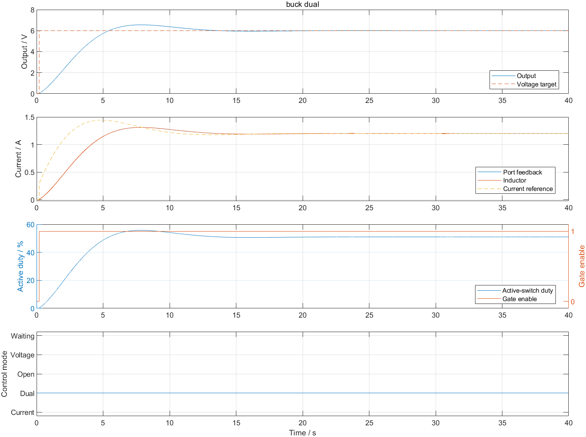
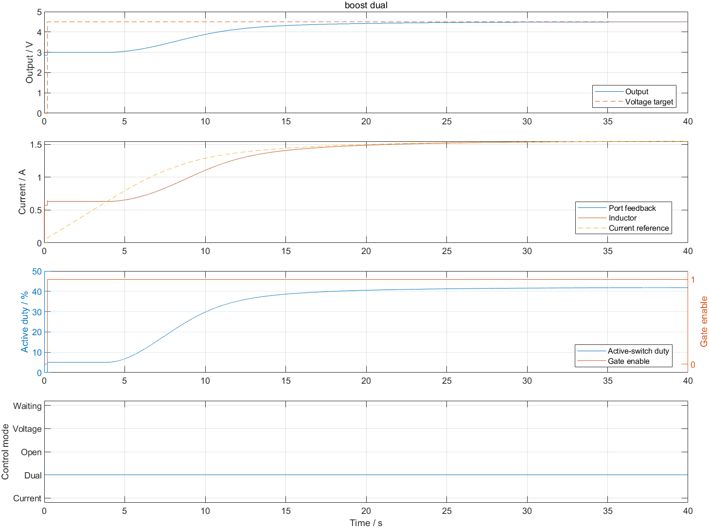

# 基于 TI C2000 F28P55X 的 Buck / Boost 数字电源实验平台

使用 **LAUNCHXL-F28P55X（TMS320F28P550SJ9）** 控制双向功率板，提供 Buck / Boost、单电流环、双闭环与开环实验；通过 SSD1306 OLED 显示状态，通过无线串口和 MCUViewer 在线观察变量、切换模式和调整 PI。

## 特别鸣谢：DigiKey 得捷 × 达尔闻 Back2School

**本项目所使用的 TI LAUNCHXL-F28P55X DSP 开发板，获得 DigiKey 得捷与达尔闻 Back2School 活动赞助支持。** 感谢活动为学生与电子技术爱好者提供动手实践机会，让数字电源控制从课堂知识走到真实的开发板、功率硬件和实验台。

本项目将这一支持落实为可以继续学习、复现与改进的资料：保留控制源码与外设配置，公开 EasyEDA（嘉立创EDA）原理图/PCB工程，配套 MATLAB 模型、模式说明与调参接线表。希望后续使用者也能沿着“理解电路 → 建模 → 上板验证 → 记录差异”的路径继续完善它。

活动与学习资料：[达尔闻活动专区](https://www.darwinlearns.com/huodong)、[达尔闻系列课程](https://www.darwinlearns.com/jpxlkc)、[DigiKey 得捷中国](https://www.digikey.cn/)。

## 从哪里开始

先看本页的模式与目标范围，再读[接线说明](docs/wiring.md) → [下载与人工调参](docs/tuning.md) → [MATLAB仿真说明](simulation/README.md)。

- [CCS源码工程](ccs_project/)：导入、配置、编译固件。
- [硬件工程](hardware/buck_boost.epro2)：嘉立创EDA原理图与PCB。
- [MCUViewer调参入口](mcuviewer/tuning.mcuvproj)：启动脚本与各模式配置均在同一目录。

## 项目能做什么

- Buck 降压、Boost 升压，保留原 STM32G474 实验版本的控制使用习惯。
- 四种主要闭环：Buck 单电流环、Buck 电压外环＋电流内环、Boost 单电流环、Boost 电压外环＋电流内环。
- Buck/Boost 开环实验；另保留 Buck 单电压环作为对照。
- 五组独立可调 PI，运行时写入参数，无需为了切换合法模式重新烧录。
- 一个外接按键按当前闭环改变电流或电压目标；OLED 显示模式、目标、反馈与通信状态。
- 上电目标为0；换模式先停机、清除目标，稳定约10ms后接纳新模式。过流、过压、ADC异常等会关闭输出。

作者已实测，控制效果与原 STM32G474 版本接近；这是一项实验观察，不是全工况定量性能报告。当前默认参数用于实验起步，未给出经统一仪器、全量程验证的效率或精度承诺。

## 为什么选 F28P55X

| 器件能力 | 对本项目的意义 | 当前使用情况 |
|---|---|---|
| 150MHz C28x 内核、FPU32 | 便于以物理单位编写浮点PI及限幅，保留人工调参可读性 | 已使用C28x与浮点控制 |
| ePWM 与 ADC 触发联动 | 采样时刻跟随PWM，减少主循环任务对控制时序的影响 | ePWM1驱动ADC，控制约20kHz |
| ADC 与相关模拟外设 | 支持多路电流、电压采样，为后续保护和观测扩展留空间 | 当前使用ADCA的4路SOC |
| CLA、TMU、CLB等资源 | 可继续研究任务并行、算法加速与硬件逻辑保护 | 当前未启用CLA/CLB，不将其计入已实现功能 |
| 官方 LaunchPad、板载 XDS110、C2000Ware/SysConfig | 可直接下载调试，也可通过图形配置检查外设和引脚 | 已使用；无线DAP不负责C2000烧录 |

上述器件能力以 [TI TMS320F28P550SJ 产品页](https://www.ti.com/product/TMS320F28P550SJ)和[LaunchPad官方资料](https://www.ti.com/tool/LAUNCHXL-F28P55X)为准。系列最大资源数不等于100引脚封装上所有通道都可同时引出。

## 模式标志与实际生效状态

| 模式 | `power_mode` | `control_mode` | 写入目标 | PI参数组 |
|---|---:|---:|---|---|
| Buck 单电流环 | 0 | 0 | `current_reference`，A | `buck_current_settings` |
| Buck 双环 | 0 | 1 | `output_voltage_target`，VBAT端V | `buck_dual_settings` |
| Buck 开环 | 0 | 2 | `openloop_command`，% | 不使用PI |
| Buck 单电压环 | 0 | 3 | `output_voltage_target`，VBAT端V | `buck_voltage_settings` |
| Boost 单电流环 | 1 | 0 | `current_reference`，输入支路A | `boost_current_settings` |
| Boost 双环 | 1 | 1 | `output_voltage_target`，VBUS端V | `boost_dual_settings` |
| Boost 开环 | 1 | 2 | `openloop_command`，% | 不使用PI |

`power_mode`、`control_mode`是可写请求；`active_power_mode`、`active_control_mode`是只读实际状态。255表示切换中或请求无效；Boost＋单电压环不支持。

上电默认 **Boost 双环，三个目标全0，输出关闭**。选择另一个MCUViewer配置文件只改变显示，不自动切换DSP模式。

切换顺序：

1. 将当前模式的目标写0，确认 `power_output_enabled=0`。
2. Buck/Boost换向前断开功率主回路，按相应方向重新确认电源和负载。
3. 写模式请求，等待两个 `active_*` 与请求一致。
4. 模式切换会清除 `current_reference`、`output_voltage_target`、`openloop_command`，并重置PI；确认新模式后再给目标。

实现入口：[control_settings.h](ccs_project/include/control_settings.h)、[app_control.c](ccs_project/app_control.c)、[pid.c](ccs_project/pid.c)。修改 `DCDC_DEFAULT_*` 后编译烧录可改变上电默认模式；运行时写标志只影响当前上电周期。

## 四种主要闭环的按键目标

外接按键：**GPIO33，排针71，按下接GND**。20ms消抖，长按不连发；板载S1是复位键，不是此按键。

| 闭环 | 目标范围 | 每次按键步进 | 从0首次按下 |
|---|---|---|---|
| Buck 单电流环 | 0.2～3.0A | 0.1A | 0.2A |
| Buck 双环 | 2.0～12.0V | 0.5V | 2.0V |
| Boost 单电流环 | 0.8～2.0A，输入支路电流 | 0.1A | 0.8A |
| Boost 双环 | 4.0～5.0V | 0.5V | 4.0V |

到上下端点后步进方向折返。Buck单电压环同样使用2～12V、0.5V步进。开环不响应按键，人工写 `openloop_command`；0停机，软件上限30%。按键没有独立的“长按停机”功能，停机应写当前目标为0。

这些是固件目标限制，不代表任意输入和负载下都能达到。实物实验负载为外接 **5Ω滑动变阻器**；例如12V输出时电阻消耗约28.8W，应按电阻实际额定功率使用。

## PI、占空比与保护

- 单电流环与双环的内环参数分别存放，虽然初值相同，后续调整互不联动。
- 电流PI：`current_kp`为占空比百分点/A，`current_ki`为百分点/(A·s)。双环电压PI：A/V、A/(V·s)。Buck单电压PI：百分点/V、百分点/(V·s)。代码内部乘50µs控制周期，人工填写的Ki不预乘周期。
- 默认单/双电流内环Kp=1、Ki=20；双环电压外环Kp=0.05、Ki=0.10；Buck单电压Kp=1、Ki=2。以头文件当前值为准。
- 当前PWM约20kHz、ADCA采样帧约40kHz、PI约20kHz。`ARR=3750`，`pwm_duty_counts`是主动开关指令计数。
- Buck主动占空比上限95%；Boost低侧储能占空比5～60%，其IR2104 IN高电平计数取补数。Boost的 `pwm_duty_counts/3750` 不能直接理解为IN高电平占空比。
- 双环电流给定上限：Buck 3A、Boost 2.5A；支路双向过流阈值默认3.2A；Buck/Boost过压阈值分别20V/7V。这些软件阈值不替代硬件额定值和硬件保护。
- `control_fault_latched`、`power_output_enabled`、`active_*`只读。故障消除、反馈安全且目标为0后才允许解除故障锁存。

## DSP接线表：GPIO号与排针号不是同一个编号

**开发板正面朝向自己、USB在上方**。正面IO.x是GPIO功能号，背面的1～80是全局排针位置。同一根穿板排针的正反两端相连，但同一面上并排的两根针通常不是同一信号。

| 功能/外设 | DSP信号 | 全局排针号 | 排针定位 |
|---|---|---:|---|
| 功率板IR2104 IN | GPIO0 / ePWM1A | 40 | J4最上端 |
| 功率板IR2104 SD#，低电平关断 | GPIO1 | 39 | J4从上第2根 |
| 电流I采样 | ADCINA6 | 23 | J3从上第3根 |
| REF采样，仅观察 | ADCINA7 | 6 | J1从上第6根 |
| VBAT信号采样 | ADCINA5 | 65 | J7从上第5根 |
| VBUS信号采样 | ADCINA9 | 46 | J5从上第6根 |
| 从DAP TX → DSP RX | GPIO15 / SCIB RX | 43 | J5从上第3根 |
| 从DAP RX ← DSP TX | GPIO56 / SCIB TX | 44 | J5从上第4根，外侧列 |
| OLED SDA | GPIO34 / I2CB SDA | 10 | J1最下端 |
| OLED SCL | GPIO51 / I2CB SCL | 9 | J1倒数第2根 |
| OLED VCC | 3.3V | 1或41 | J1或J5最上端 |
| 公共地 | GND | 20、22、60、62 | 见详细接线图 |
| 目标步进按键 | GPIO33 | 71 | J8最下端，按下接GND |

GPIO56旁边的内侧针是排针64的ADC信号，不能因为靠近IO.56丝印就任选一根。S2串口选择拨码置0/0；S3置Flash启动1/1。完整定位见[引脚分配与接线](docs/wiring.md)与[TI LaunchPad用户指南](https://www.ti.com/lit/ug/sprujc0a/sprujc0a.pdf)。

OLED为SSD1306 128×64、I²C，使用3.3V供电，默认地址0x3C，兼容探测0x3D。ADC连接的是调理后的0～3.3V信号，不能直接连接功率端口电压；采集板AGND与DSP GND共地。REF当前只观察，不在电流计算里重复扣除；移植自STM32的零点/增益仍须在本DSP标定。

## 编译、烧录和在线调参

已验证环境：CCS21.0.1、C2000Ware26.02、内置SysConfig1.28.1、TI C2000编译器25.11.1.LTS；调参使用MCUViewer1.4.0和Python3＋pyserial。工具和SDK不随仓库分发，其他电脑先安装相应工具，并在CCS关联本机SDK。

1. 在CCS导入[ccs_project](ccs_project)，打开 `buck_f28p55x.syscfg`检查外设；选择 **CPU1_FLASH** 构建。CPU1_RAM只用于在线调试，断电不保留。
2. 用板载 **XDS110 USB** 下载 `CPU1_FLASH/BUCK_F28P55X.out`。下载后若暂停在main，继续运行；完整断电启动应另做验证。
3. 电脑端无线DAP通过USB连接电脑，从DAP用TX/RX/GND接DSP。DAP的CLK/DIO不接DSP，当前不支持用这对DAP进行C2000烧录。
4. 运行 `python tools/prepare_mcuviewer.py --port COM14`，按当前FLASH map生成变量地址。在线调参不能使用其他构建或其他芯片的旧地址。
5. 本机可运行[mcuviewer/Open_MCUViewer.cmd](mcuviewer/Open_MCUViewer.cmd)，自动启动本地桥接并打开调参。其他电脑设置MCUVIEWER_EXE、OFD2000_EXE及实际DAP串口号，Python依赖见requirements.txt。
6. MCUViewer连接选择 **GDBSERVER → 127.0.0.1:3334**；桥接占用无线DAP的115200串口。保持C2000 ELF解析器与本机ofd2000路径；不要切回本机曾出现写入报错的SERIAL方式。
7. 在[mcuviewer/profiles](mcuviewer/profiles)选择对应控制方案，每页不超过20个变量。打开配置只改变显示，模式仍由两个标志请求决定。

默认调参入口：[mcuviewer/tuning.mcuvproj](mcuviewer/tuning.mcuvproj)。MCUViewer1.4可将其保存为新.mcuv格式。细节见[下载与人工调参](docs/tuning.md)。桥接只实现内存读写，并限制可写范围，不提供CPU暂停、复位或烧录。

独立供电运行与无线读写已验证；七种合法模式组合已完成零目标实板切换，输出保持关闭。带功率运行效果由作者实测反馈；仓库没有统一仪器记录支撑的全范围性能曲线。连接功率前先核对ADC零点、增益、电流方向，再限流上电；首次不要直接运行范围上限。

## MATLAB配套仿真

入口：[simulation/run_project_simulation.m](simulation/run_project_simulation.m)，参数：[project_parameters.m](simulation/project_parameters.m)，说明：[simulation/README.md](simulation/README.md)。仿真针对本项目的Buck/Boost控制实验，不使用竞赛指标或其他赛题的控制方案。

```matlab
addpath('simulation');
run_project_simulation;
```

提供四种主要闭环、两种开环、Buck单电压环，以及同方向电流环→双环切换的示例。控制器采用与固件一致的误差方向、PI条件积分、占空比单位和比较寄存器量化；默认PI从固件头文件读取。模型保留低压端440µF及支路阻抗，反馈端口电流与电感电流分开绘制。

确认值：负载5Ω、C18/C19合计440µF。电感量尚未提供，默认100µH仅为建模假设；母线电容、等效电阻、示例输入电压也在参数文件明确列出。结果用于解释控制行为和做参数实验，不能代替器件损耗、开关纹波、ADC校准与实物性能测试。仿真参数/局限和生成结果以simulation目录说明为准。

仿真示例（图中为参数假设下的平均响应）：





## 目录与许可证

```text
Buck-Boost-DSP-Controller/
├── README.md                 项目介绍与使用入口
├── ccs_project/              CCS工程与固件源码
├── hardware/                 嘉立创EDA工程
├── simulation/               MATLAB仿真与结果图
├── mcuviewer/                在线调参入口与配置
├── docs/                     接线、调参和验证记录
├── tools/                    构建、桥接及验证工具
├── licenses/                 第三方许可证
├── LICENSE                   自有软件MIT许可
├── THIRD_PARTY_NOTICES.md     第三方许可范围
└── requirements.txt          Python依赖
```

本机生成的 `build/`、CCS构建输出和仿真原始数据由Git忽略，GitHub目录中不会出现。CCS工作区文件放在 `ccs_project/` 内；直接导入该目录即可。

本轮已重新生成许可清晰的OLED字库并编译；未重新烧录实板，字形变化尚待目视确认。控制逻辑保持不变。

自有软件采用[MIT许可证](LICENSE)，第三方文件保留各自原许可，详见[THIRD_PARTY_NOTICES.md](THIRD_PARTY_NOTICES.md)。硬件源文件不自动套用软件MIT许可；具体硬件再分发授权由作者另行确认。仓库中不包含CCS、C2000Ware、MATLAB、MCUViewer安装包或Python环境。
